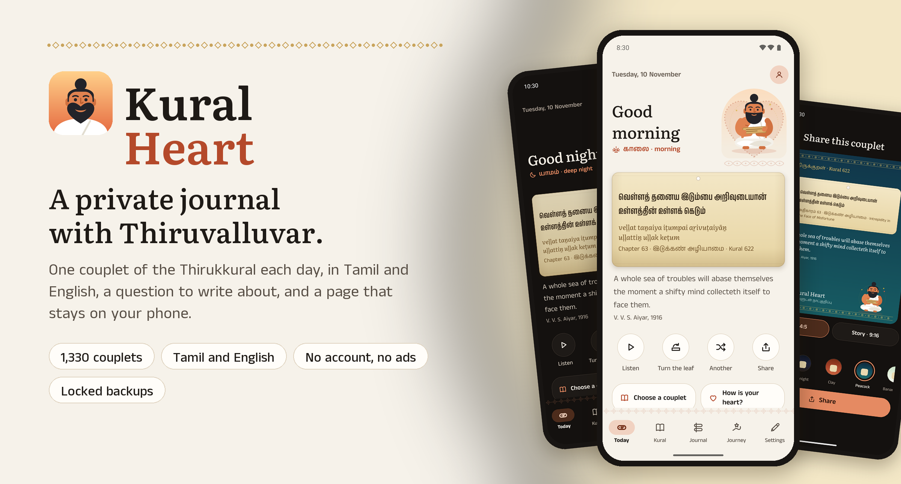
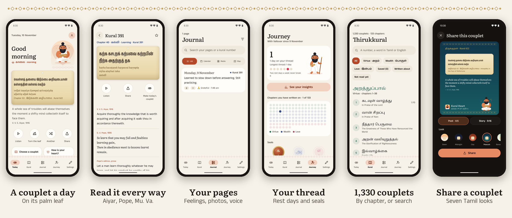

<p align="center">
  
</p>

<p align="center">
  <a href="../../releases/latest/download/kuralheart.apk"></a>
  <a href="https://inigo-code.github.io/kural-heart-site/"></a>
  
  
  
  
</p>

<h3 align="center">One couplet a day. One quiet page to write.</h3>

<p align="center">
<b>Kural Heart</b> brings you one couplet of the Thirukkural each day, on its palm leaf, in Tamil and English,<br/>
with a question to write about and a page that stays on your phone. Free, with no account, no ads and no tracking.
</p>

<br/>

## 🌿 Highlights

<table>
  <tr>
    <td width="33%" valign="top">
      <h4>🍃 A couplet a day</h4>
      All 1,330 couplets, each on a palm leaf and always flush left, with a pronunciation line (simple, or scholarly ISO 15919) for readers new to Tamil. Turn the leaf for Pope's verse.
    </td>
    <td width="33%" valign="top">
      <h4>📖 Read it every way</h4>
      V. V. S. Aiyar's English (1916), G. U. Pope's verse and prose (1886), and with Tamil first, Mu. Varadarasanar's Tamil explanation. Browse by chapter, search, save.
    </td>
    <td width="33%" valign="top">
      <h4>✍️ A question to write about</h4>
      For the mind, for speech and for action. Bold, lists and checklists, a feeling, photos, a voice note or a short video, the place and the weather.
    </td>
  </tr>
  <tr>
    <td valign="top">
      <h4>🧵 A thread, not a streak</h4>
      Two rest days a week are kept for you, nine seals mark the way, and 133 chapter beads fill as you write.
    </td>
    <td valign="top">
      <h4>📊 Insights</h4>
      Your words over time, the days and hours you write, your feelings and the chapters you return to. Worked out on the phone.
    </td>
    <td valign="top">
      <h4>🎨 Share a couplet</h4>
      Stories and posts in seven looks from Tamil life: dawn, midnight, clay, peacock, banana leaf, jasmine and turmeric. Your own words only if you add them.
    </td>
  </tr>
  <tr>
    <td valign="top">
      <h4>🔊 Listen</h4>
      Each couplet read aloud in your phone's Tamil voice, then the English if you like, with Valluvar reciting along.
    </td>
    <td valign="top">
      <h4>🌗 Ivory or Midnight</h4>
      A warm paper look or a dark one, or follow your phone. Four accents, four text sizes, fingerprint App lock.
    </td>
    <td valign="top">
      <h4>🔐 Locked backups</h4>
      One file sealed with a passphrase only you know, to a folder or to a hidden app folder in your own Google Drive.
    </td>
  </tr>
</table>

<br/>

<p align="center">
  
</p>

## ⬇️ Install

1. On your Android phone (Android 7 or later), tap **[Download APK](../../releases/latest/download/kuralheart.apk)** (or open the [latest release](../../releases/latest)).
2. Open the file. If Android asks, allow your browser to install apps. If Play Protect warns, choose **Install anyway**.
3. New versions install over the old one and keep your journal. Smaller updates also arrive inside the app.

> Kural Heart asks only for what you use: **Internet**, for the place, weather, maps, Drive and updates; **Location**, only to add a place to a page; **Camera** and **Microphone**, only for a photo, video or voice note; **Notifications**, for the morning couplet.

## 🔒 Your data

- **On your phone.** Pages, photos, voice notes and videos are encrypted on the phone (AES-256-GCM) with a key kept in Android's secure storage.
- **No account.** Nothing to sign up for. Nothing leaves the phone unless you turn it on.
- **Backups only you can open.** A single file sealed with your passphrase (PBKDF2 and AES-256-GCM), to a folder you choose or to Google Drive's private app folder. Kural Heart can't see anything else in your Drive.
- **No ads, no analytics, no tracking.** See the [privacy policy](https://inigo-code.github.io/kural-heart-site/privacy.html).

## 📚 Sources

- The Tamil couplets: Project Madurai's e-text 0001, checked line by line against e-text 0017 and a third copy (`tools/content/build_pack.py`, report in `tools/content/report.md`).
- English: V. V. S. Aiyar (Standard Ebooks, public domain) and G. U. Pope (Project Madurai e-text 0153).
- Tamil explanation: Mu. Varadarasanar's Thirukkural Thelivurai (1969), nationalised by the Government of Tamil Nadu (CC0), from Tamil Wikisource.
- Fonts: Anek Tamil, Noto Serif Tamil and Literata, SIL Open Font License.
- Maps: © OpenStreetMap contributors. Weather: Open-Meteo.

## 🛠️ Built with

Expo (SDK 58), React Native, Expo Router, Skia for Valluvar and the kolam patterns, EAS builds and updates. Read `PRODUCT.md` and `PLAN.md` before changing anything; `CLAUDE.md` lists the layout and the commands.

```bash
npm ci
npm run typecheck && npm run lint
```

## ✉️ Contact

Inigo, inigo@tosstheworld.org. Part of [Heart Apps](https://inigo-code.github.io/).
